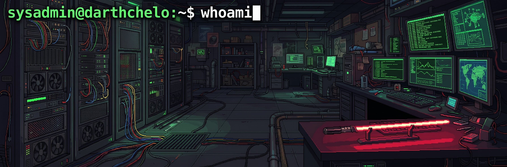

  

# 👾 Welcome to the Dark Side of the Homelab

**`sysadmin@darthchelo:~$ whoami`**

Hola, soy **Marcelo Bugallo (DarthChelo)**. Radicado en Avellaneda, Argentina, dedico mi tiempo libre a destruir y reconstruir infraestructuras en mi laboratorio, investigar amenazas digitales y evangelizar sobre ciberseguridad.

> 👔 **¿Buscas mi perfil corporativo?** Mi trayectoria formal como Cybersecurity Manager y Estratega DRPX vive en [**LinkedIn**](https://linkedin.com/in/mbugallo/). Aquí solo encontrarás código, terminales y R&D.

---

## 🔬 The R&D Homelab

Mi infraestructura local es donde ocurre la magia (y donde rompo cosas a propósito). Operando 24/7 sobre:

*   **Hypervisors & OS:** Proxmox VE. En mis equipos personales, siempre Linux (Ubuntu MATE, Arch Linux + Hyprland en Wayland).
*   **Storage Core:** QNAP TS-473A respaldado por la solidez de ZFS (QuTS hero).
*   **Networking & Defense:** Firewalls Fortinet, segmentación de red agresiva (Zero Trust) y automatización ruda con PowerShell y Bash.
*   **Cloud Sandbox:** Entornos híbridos de prueba destruibles en AWS y Microsoft Azure.

## 📺 Evangelización Hacker
Creo firmemente en democratizar el conocimiento. Soy el creador y host de **[Tu Defensa Digital](https://www.youtube.com/@TuDefensaDigital)**, donde traduzco conceptos complejos de ciberseguridad y OSINT para el usuario de a pie y PyMEs. 

## 🛠️ Repositorios Destacados

*   🔥 [**fortinet-hardening-templates**](#): Mis baselines y políticas "Deny All" para asegurar perímetros.
*   ☁️ [**azure-sec-networking-sandbox**](#): IaC puro para levantar arquitecturas de red seguras en segundos.
*   🖥️ [**proxmox-zfs-automation**](#): Scripts para domar Proxmox y ZFS sin tocar la GUI.
*   📚 [**ciberseguridad-para-todos**](https://github.com/DarthChelo/ciberseguridad-para-todos): Todos los laboratorios y cheat sheets de mis clases.

---
### 📡 Transmisión de Contacto
*   **Ping:** `bugallomarcelo@gmail.com`
*   **Broadcast:** [YouTube - Tu Defensa Digital](https://www.youtube.com/@TuDefensaDigital)
*   **Handshake:** [LinkedIn](https://linkedin.com/in/mbugallo/)

  

